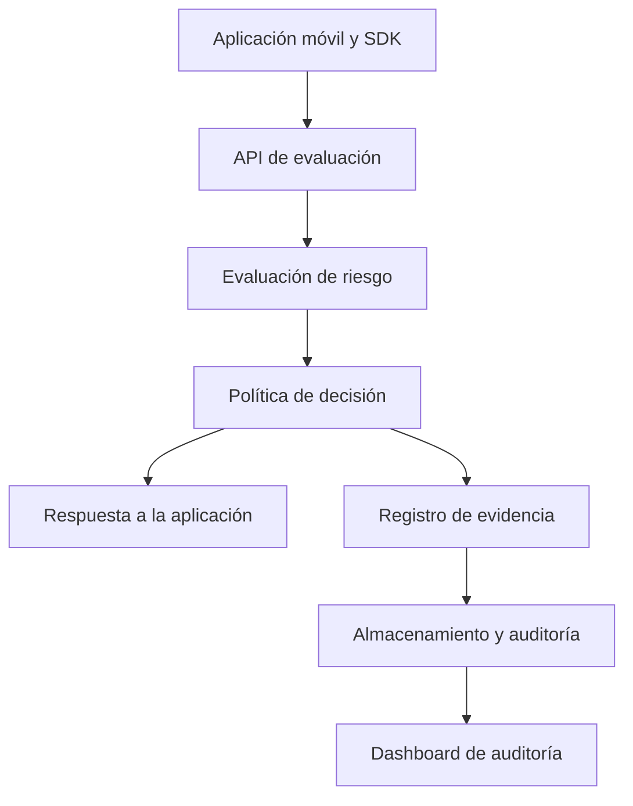

# SHADOW BLACK CORE

**SDK de ciberseguridad para aplicaciones móviles**

> «Un sistema no se mide por cuánto dura de pie, sino por cuánto tarda en recuperarse.»

SHADOW BLACK CORE es un proyecto orientado a explorar controles de integridad, evaluación de riesgo y evidencia auditable para aplicaciones móviles. Este repositorio está en una etapa inicial: las ideas de arquitectura descritas aquí son una propuesta de diseño, no una afirmación de que los componentes, pruebas o servicios estén implementados o desplegados.

## Estado del proyecto

**En diseño / prototipo.** Antes de usarlo en producción, se deben implementar y revisar los componentes, validar la configuración de nube, ejecutar pruebas reproducibles y realizar una evaluación de seguridad independiente. No conectes este proyecto a sistemas bancarios ni a datos reales sin esas revisiones.

## Objetivos

- Evaluar señales de integridad y riesgo en una aplicación móvil.
- Registrar decisiones de forma que puedan auditarse y verificarse.
- Aplicar privilegio mínimo y separar los servicios por función.
- Degradar de forma controlada ante fallos de servicios de modelos o dependencias.
- Evitar presentar métricas, resultados de pruebas o ahorros como hechos hasta que tengan evidencia reproducible.

## Arquitectura propuesta

La infraestructura sugerida contempla servicios de Google Cloud como Cloud Run o GKE, Vertex AI, BigQuery, Cloud Storage, Cloud KMS, VPC Service Controls e IAM. La selección final debe basarse en requisitos, costos, disponibilidad regional y una revisión de seguridad. No se incluye aquí una configuración de despliegue validada.

## Áreas de investigación

- **Integridad de la aplicación:** señales de manipulación y verificación de artefactos.
- **Análisis de riesgo:** evaluación de eventos y secuencias. FFT, modelos probabilísticos, cadenas de Markov y detección de drift son opciones por evaluar, no capacidades confirmadas.
- **Políticas de sesión:** respuestas graduadas según el riesgo, definidas y probadas con requisitos del producto.
- **Evidencia auditable:** hashes y registros verificables. Un hash por sí solo no demuestra el origen, integridad de todo el flujo ni resistencia a manipulación; esos aspectos requieren diseño adicional y controles de claves.
- **Pruebas:** pruebas unitarias, integración y pruebas de seguridad en entornos autorizados y aislados.

## Seguridad y uso responsable

Las pruebas de seguridad deben ejecutarse únicamente contra entornos propios o para los que exista autorización explícita. Los ejemplos de ataques o simulaciones no deben dirigirse a aplicaciones, usuarios o infraestructura de terceros.

Antes de cualquier despliegue se requiere, como mínimo:

1. Revisar permisos IAM, redes, exposición pública y gestión de secretos.
2. Validar Terraform con `terraform fmt`, `terraform validate` y un `terraform plan` revisado por una persona autorizada.
3. Probar los controles en un entorno no productivo y confirmar los modos de fallo y recuperación.
4. Verificar que los datos almacenados no incluyan información personal o credenciales innecesarias.
5. Revisar dependencias, imágenes de contenedor, registros y políticas de retención.

No ejecutes `terraform apply` ni publiques credenciales basándote únicamente en este documento.

## Métricas y afirmaciones

No se publican porcentajes de cobertura o detección, tiempos de respuesta, costos de bypass, comparaciones con otros productos ni resultados de pruebas como resultados del proyecto mientras no exista evidencia verificable y reproducible que los respalde. Los valores hipotéticos o demostrativos deben identificarse claramente como tales.

## Desarrollo

El repositorio todavía no define un proceso de instalación o ejecución estable. Cuando se incorporen componentes ejecutables, esta sección deberá documentar versiones compatibles, configuración local, comandos de pruebas y limitaciones conocidas.

## Autoría y licencia

Proyecto asociado a **Edmundo Ramírez Jiménez**.

La licencia configurada para este repositorio es **GNU GPL v3.0**. Por lo tanto, el código distribuido debe respetar los términos de esa licencia; no se debe describir el proyecto como “Proprietary” salvo que la licencia del repositorio cambie de forma válida.
